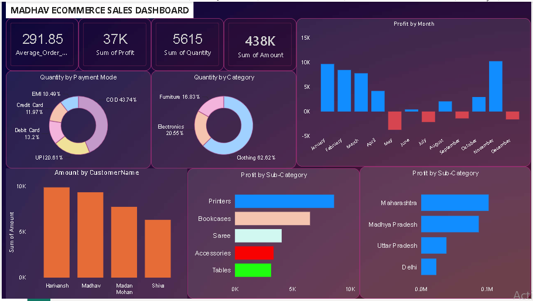

# 📊 Data Analytics Portfolio

Hi, I'm **Piyush Verma**!

Welcome to my Data Analytics Portfolio. This repository showcases my projects in data visualization, business intelligence, and data analysis.

I use data visualization and analytical techniques to explore business performance, identify trends, and present insights through interactive dashboards.

## 🛠️ Skills & Tools

- **Business Intelligence:** Microsoft Power BI
- **Data Analysis:** SQL, Python
- **Data Visualization:** Interactive dashboards, charts, and KPIs
- **Data Preparation:** Power Query, where applicable

## 📁 My Projects

### 1. 📱 Mobile Sales Analysis Dashboard

An interactive Power BI dashboard designed to analyze mobile sales performance, transaction patterns, payment methods, and customer ratings.

**Key Features**
- Sales performance KPIs
- Daily and monthly sales analysis
- Sales comparison across periods
- Mobile model performance
- Payment method analysis
- Customer rating analysis

**Tool:** Microsoft Power BI

**Dashboard Preview**

➡️ **[Explore Mobile Sales Dashboard](PowerBI-Mobile-Sales/README.md)**

---

### 2. 🛒 E-commerce Sales Analysis Dashboard

A Power BI dashboard focused on e-commerce sales, profitability, product categories, customer contributions, payment methods, and regional performance.

**Key Features**
- Average order value, total profit, quantity, and sales amount
- Monthly profit trends
- Product category analysis
- Payment method distribution
- Customer-level sales analysis
- Product sub-category profitability
- State-level profit analysis

**Tool:** Microsoft Power BI

**Dashboard Preview**

➡️ **[Explore E-commerce Sales Dashboard](PowerBI-Ecommerce-Sales/README.md)**

---

## 🎯 Career Objective

I am interested in opportunities where I can apply my analytical thinking, SQL skills, and data visualization knowledge to transform data into meaningful business insights.

I am continuously developing my skills through practical projects and hands-on analysis.

---

## 📬 Connect With Me

- **GitHub:** [Piyush-Verma-07](https://github.com/Piyush-Verma-07)

---

*More data analytics projects will be added as I continue learning and building.*
